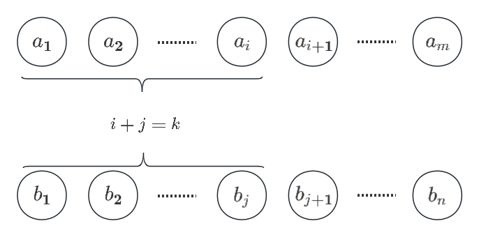
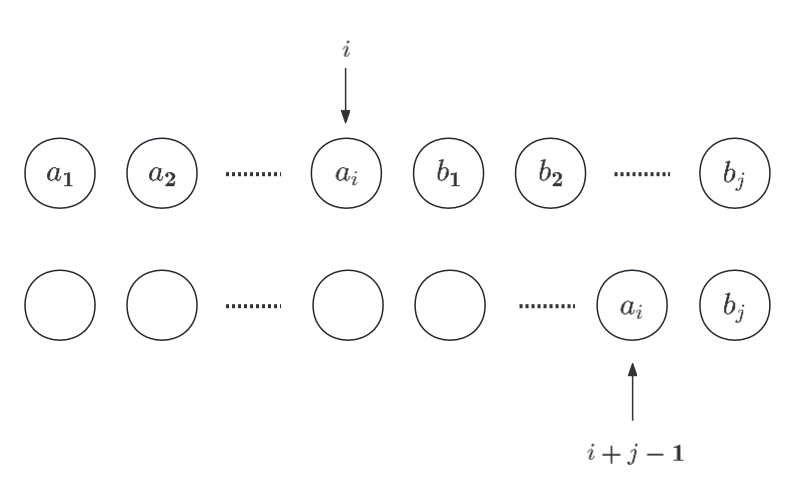
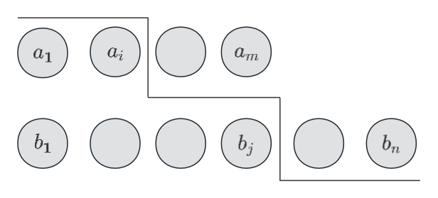
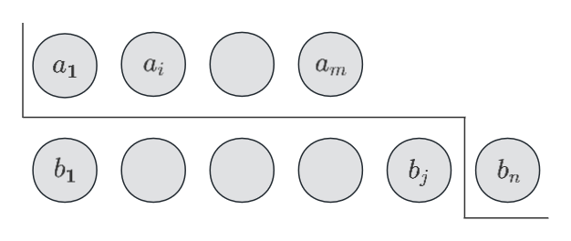
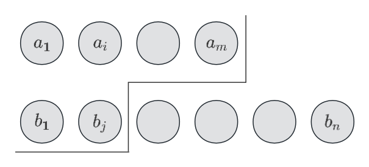
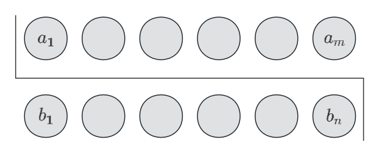
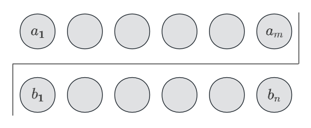

## 寻找两个正序数组的中位数

### 问题

给定两个大小分别为 `m` 和 `n` 的正序（从小到大）数组 `nums1` 和 `nums2`。请你找出并返回这两个正序数组的 **中位数** 。

算法的时间复杂度应该为 `O(log (m+n))` 。

提示：

- `nums1.length == m`
- `nums2.length == n`
- `0 <= m <= 1000`
- `0 <= n <= 1000`
- `1 <= m + n <= 2000`
- $-10^6\leq$ `nums1[i], nums2[i]` $\leq 10^6$

### 思路一（二分）

根据中位数的定义，当 $m+n$ 是奇数时，中位数是两个有序数组中的第 $(m+n)/2$ 个元素；当 $m+n$ 是偶数时，中位数是两个有序数组中的第 $(m+n)/2$ 个元素和第 $(m + n)/2 + 1$ 个元素的平均值。

将问题转化为**寻找两个有序数组的第 $k$ 小的数**，假设两个数组的下标都是从 1 开始。

首先在数组 $a$ 中，下标为 $i$ 的元素恰好是该数组的第 $i$ 小元素；同理在数组 $b$ 中，下标为 $j$ 的元素恰好是该数组的第 $j$ 小元素。最终一定是满足 $i+j=k$，在其右边界上找到第 $k$ 小元素。



那先赋值随意合法的 $i,j$ 满足 $i + j = k$，比较 $a_i,b_j$：

- 若 $a_i \leq b_j$，那么在将前缀 $a[1 \sim i],b[1 \sim j]$ 合并后，$a_i$ 最少是该数组的第 $i$ 小，最多是该数组的第 $k-1$ 小，无论如何都不会是第 $k$ 小。又因为 $a[1 \sim i-1] \leq a_i$ 那么将 $a[1 \sim i]$ 从数组 $a$ 中删去，此时再寻找两个数组的第 $k-i$ 大元素。
- 若 $a_i > b_j$，同理将 $b[1 \sim j]$ 从数组 $b$ 中删去，此时再寻找两个数组的第 $k-j$ 大元素。



> 证明：设 $a_i \leq b_j$，对于最终答案来说，$a$ 的边界指针一定不小于 $i$，$b$ 的边界指针一定不大于 $j$，该结论可以根据已有的大小关系使用反证法证明。那么再次调整 $a$ 和 $b$ 前缀时，$a[1 \sim i]$ 一定会在两个数组第 $k$ 小元素的前面，因此将其删除，再去寻找此时两个数组的第 $k-i$ 小元素，和原问题是等价的。

为了达到 $\log$ 的 时间复杂度，我们可以每次删除一半的元素，即每次分别取两个数组的前 $k/2$ 个元素。但此时需要处理一下如下的特殊情况：

- 如果 $a[k/2]$ 或 $b[k/2]$ 越界，那么可以选取对应数组中最后一个元素，那么**必须根据排除数的个数减少 $k$ 的值**
- 如果一个数组为空，说明该数组中所有元素都被排除，可以直接返回另一个数组中第 $k$ 小的元素
- 如果 $k=1$，只需要返回两个数组首元素的最小值 

#### 时空复杂度

时间复杂度 $O(\log n)$

空间复杂度 $O(1)$​

#### 代码

```C++
class Solution {
 public:
  int getKthElement(vector<int>& nums1, vector<int>& nums2, int k) {
      int n = nums1.size(), m = nums2.size();
      int i = 0, j = 0;
      while(true) {
          if(i >= n) return nums2[j + k - 1];
          if(j >= m) return nums1[i + k - 1];
          if(k == 1) return min(nums1[i], nums2[j]);
          int cnt = k / 2 - 1;
          int l = i + cnt >= n ? n - 1 : i + cnt;
          int r = j + cnt >= m ? m - 1 : j + cnt;
          if(nums1[l] <= nums2[r]) {
              k -= l - i + 1;
              i = l + 1;
          } else {
              k -= r - j + 1;
              j = r + 1;
          }
      }
  }

  double findMedianSortedArrays(vector<int>& nums1, vector<int>& nums2) {
      int n = nums1.size(), m = nums2.size();
      if((n + m) & 1) {
          return getKthElement(nums1, nums2, (n + m) / 2 + 1);
      } else {
          int x = getKthElement(nums1, nums2, (n + m) / 2);
          int y = getKthElement(nums1, nums2, (n + m) / 2 + 1);
          return (x + y) * 1.0 / 2;
      }
  }
};
```

### 思路二（二分）

假设先求出第 $k = (m + n + 1)/2 + 1$ 小的元素，该元素在两个序列长度和为奇数时恰为中位数，和为偶数是为中位数分隔线的左边的元素



如上图所示，要求出两个数组的中位数，一定是采用了这样的分隔方式，两个隔板左边的元素均小于等于右边的元素。且分隔后满足：
$$
\left\{\begin{array}{rcl} i + j = k \\ a_i \leq b_{j+1} \\ b_j \leq a_{i + 1}  \end{array}\right. \tag{1}
$$
那么我们只需要求出 $\max(a_i, b_j)$ 和 $\min(a_{i + 1}, b_{j+1})$ 就可以求出两个序列的中位数。

假设数组 $a$ 的长度小于等于数组 $b$ 的长度，考虑首先移动 $a$ 隔板的位置 $x$，那么 $b$ 隔板的位置就可以由 $k-x$ 直接求出。假设固定了 $a$ 隔板的位置，如果不满足 $(1)$ 式：

- 若 $a_i > b_{j+1}$，此时 $a_i$ 太大，不能满足两个隔板左侧元素小于等于右边的元素，数组 $a$ 的隔板需要向左移动
- 若 $a_{i + 1} < b_{j}$，此时 $a_i$ 太小，不能满足两个隔板左侧元素小于等于右边的元素，数组 $a$ 的隔板需要向右移动

找到了数组 $a$ 隔板移动的单调性，那么就可以通过二分解决该问题。但是此时还存在一些细节判断。

**边界一**



**边界二**



**边界三**



**边界四**



考虑如下的代码实现细节：

- 对**长度较小**的数组进行二分。
- 枚举该数组**隔板右侧元素**的位置。
- 设置二分停止的右边界为数组右侧的**第一个越界长度。**

上述实现方式保证了 $b$ 数组隔板的**右侧元素位置不越界**，即始终处于合法的下标上。对于第四种边界情况，数组 $a$ 的隔板已经越界，若采取更新指针 $r$ 为 $mid$ 的方式，二分循环会跳出，即不会取到 $b[-1]$ 这个非法位置；对于第一、第三种情况，数组 $a$ 已经到达左边界，若采取更新指针 $l$ 为 $mid$ 的方式，二分循环会跳出，即不会取到 $a[-1]$ 这个非法位置。

#### 时空复杂度

时间复杂度 $O(\log n)$

空间复杂度 $O(1)$

#### 代码

```C++
const int inf = 0x3f3f3f3f;

class Solution {
public:
    double findMedianSortedArrays(vector<int>& nums1, vector<int>& nums2) {
        if (nums1.size() > nums2.size()) {
            swap(nums1, nums2);
        }
        int m = nums1.size(), n = nums2.size();
        int k = (m + n + 1) / 2;
        int l = 0, r = m, i, j;
        while (l < r) {
            i = (l + r) >> 1;
            j = k - i;
            if (nums1[i] > nums2[j - 1]) {
                r = i;
            } else {
                l = i + 1;
            }
        }
        i = l, j = k - l;
        int ans1 = -inf, ans2 = inf;
        if (i - 1 >= 0) ans1 = max(ans1, nums1[i - 1]);
        if (j - 1 >= 0) ans1 = max(ans1, nums2[j - 1]);
        if ((n + m) & 1) return ans1;
        if (i < m) ans2 = min(ans2, nums1[i]);
        if (j < n) ans2 = min(ans2, nums2[j]);
        return (ans1 + ans2) * 1.0 / 2;
    }
};
```

