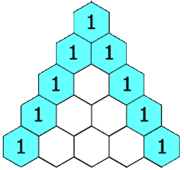

## 杨辉三角

### 问题

给定一个非负整数 *`numRows`，*生成「杨辉三角」的前 *`numRows`* 行。

在「杨辉三角」中，每个数是它左上方和右上方的数的和。



提示：

- `1 <= numRows <= 30`

### 思路（递推）

递推公式为：
$$
C_n^m=C_{n-1}^m+C_{n-1}^{m-1}
$$

#### 时空复杂度

时间复杂度 $O(n^2)$

空间复杂度 $O(1)$​

#### 代码

```C++
class Solution {
public:
    vector<vector<int>> generate(int numRows) {
        vector<vector<int>> f(numRows, vector<int>(numRows, 0));
        vector<vector<int>> ans;
        f[0][0] = 1;
        ans.push_back({1});
        for (int i = 1; i < numRows; i++) {
            vector<int> res;
            f[i][0] = 1;
            res.push_back(1);
            for (int j = 1; j <= i; j++) {
                f[i][j] = f[i - 1][j] + f[i - 1][j - 1];
                res.push_back(f[i][j]);
            }
            ans.push_back(res);
        }
        return ans;

    }
};
```
