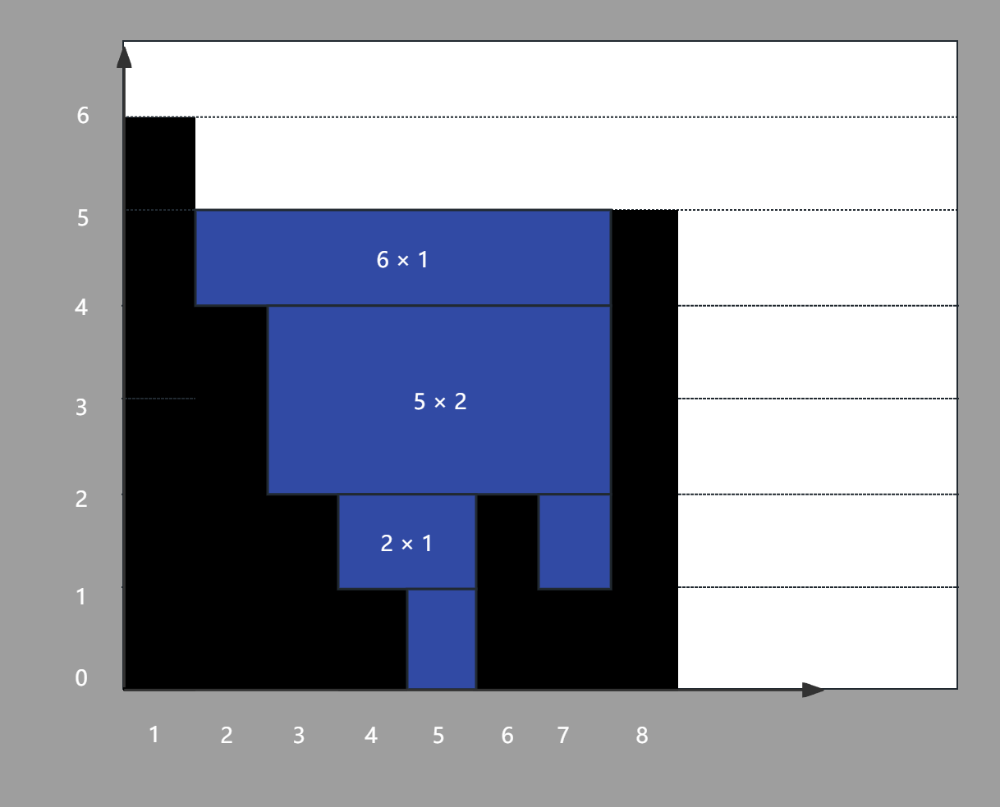

## 接雨水

### 问题

给定 `n` 个非负整数表示每个宽度为 `1` 的柱子的高度图，计算按此排列的柱子，下雨之后能接多少雨水。


提示：

- `n == height.length`
- $1 \leq n \leq 2 \times 10^4$
- $0 \leq$ `height[i]` $\leq 10^5$

### 思路一（双指针）

**本做法为竖着考虑问题**

对于每个位置，想象成一个宽度为 1 的木桶，木桶的左右木板高度决定了它接水的容量。

- 左边木板的高度取决于**左边的最大高度**
- 右边木板的高度取决于**右边的最大高度**

因此可以通过计算每个位置的前后缀最大值，然后减去木桶本身的容量，就可以求出每个位置能接水的容量。这样的做法时间复杂度是 $O(n)$，空间复杂度为 $O(n)$

对于每个位置 $i$，影响其答案的是两个木板的最小值 **min(leftMax[i], rightMax[i])**，若已经得到 `leftMax[i]` 且它小于当前后缀中的最大值，根据后缀最大值单调不减的性质，那么可以直接计算出答案。因此初始设置两个指针分别指向数组首尾，然后相向移动，每次只需要移动较小的木板，因为**较小木板所处位置可以求出答案**，重复此过程直到指针相会。

#### 时空复杂度

时间复杂度 $O(n)$

空间复杂度 $O(1)$​

#### 代码

```java
class Solution {
public:
    int trap(vector<int>& height) {
        int n = height.size();
        int l = 0, r = n - 1;
        int pre = 0, suf = 0;
        int ans = 0;
        while (l < r) {
            if (height[l] < height[r]) {
                pre = max(pre, height[l]);
                ans += pre - height[l];
                l++;
            } else {
                suf = max(suf, height[r]);
                ans += suf - height[r];
                r--;
            }
        }
        return ans;
    }
};
```

### 思路二（单调栈）

**本做法为横着考虑问题**



如上图所示，**为每个位置的柱子最高处向右侧做一条水平线**，最终有水的部分都被分成了若干个矩形，考虑横着计算所有矩形的容量。矩形的高度由如下条件得出：

- 每个矩形的底边被某个高度的柱子 $A$ 支撑，固定了矩形的高度
- 每个矩形被两个柱子 $B,C$ 围住，固定了矩形的宽度

为了保证每个矩形只被计算一次，把填入的矩形视为实体加到柱子的高度上。当计算位置 $i$ 上方支撑的矩形时，前面填好柱子的高度一定是单调不增的。

维护一个**单调递减**的单调栈，在一个元素逐步入栈的过程，**找上一个更大元素，找的过程中计算横向容量**，相当于枚举每个柱子 $C$ 时计算填充矩形的面积。面积由三个元素决定：**当前元素，栈顶元素，栈顶下的元素**，已经计算过的栈顶元素出栈。过程如下：

- 若栈不为空，且当前下标为 $i$ 元素 $h[i]$ 大于等于栈顶元素 $h[t]$
  - 若栈中至少有两个元素，栈顶元素的上一个元素为 $h[p]$，则累加 $\min(h[i], h[p]) - h[t]) * (i - p - 1)$
  - 栈顶下标出栈
- 将当前元素入栈

#### 时空复杂度

时间复杂度 $O(n)$

空间复杂度 $O(n)$​

#### 代码

```java
class Solution {
public:
    int trap(vector<int>& height) {
        int n = height.size();
        vector<int> stk;
        int ans = 0;
        for (int i = 0; i < n; i++) {
            while (!stk.empty() && height[i] >= height[stk.back()]) {
                if (stk.size() > 1) {
                    int j = *next(stk.rbegin());
                    ans += (min(height[j], height[i]) - height[stk.back()]) * (i - j - 1);
                }
                stk.pop_back();
            }
            stk.push_back(i);
        }
        return ans;
    }
};
```

