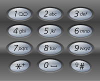

## 电话号码的字母组合

### 问题

给定一个仅包含数字 `2-9` 的字符串，返回所有它能表示的字母组合。答案可以按 **任意顺序** 返回。

给出数字到字母的映射如下（与电话按键相同）。注意 1 不对应任何字母。



提示：

- `0 <= digits.length <= 4`
- `digits[i]` 是范围 `['2', '9']` 的一个数字。

### 思路（搜索）

首先采用哈希表存储每个数字对应的所有可能的字母，然后进行搜索。搜索过程中维护一个字符串，表示已有的字母排列。该字符串初始为空。每次取电话号码的一位数字，从哈希表中获得该数字对应的所有可能的字母，并将其中的一个字母插入到已有的字母排列后面，然后继续处理电话号码的后一位数字，直到处理完电话号码中的所有数字，即得到一个完整的字母排列。然后进行回退操作，遍历其余的字母排列。

#### 时空复杂度

时间复杂度 $O(3^m\times4^n)$

空间复杂度 $O(n+m)$​

#### 代码

```C++
class Solution {
private:
    static const vector<vector<char>> ch;
    vector<int> a;

    void dfs(int d, int n, vector<string>& ans, string& s) {
        if (d == n) {
            ans.push_back(s);
            return;
        }
        int idx = a[d];
        for (char c : ch[idx]) {
            s.push_back(c);
            dfs(d + 1, n, ans, s);
            s.pop_back();
        }
    }
public:
    vector<string> letterCombinations(const string& digits) {
        vector<string> ans;
        if (digits.empty()) return ans;
        for (char digit : digits) {
            int j = digit - '0';
            a.push_back(j - 2);
        }
        string s;
        dfs(0, digits.size(), ans, s);
        return ans;
    }
};

const vector<vector<char>> Solution::ch = {
    {'a', 'b', 'c'},
    {'d', 'e', 'f'},
    {'g', 'h', 'i'},
    {'j', 'k', 'l'},
    {'m', 'n', 'o'},
    {'p', 'q', 'r', 's'},
    {'t', 'u', 'v'},
    {'w', 'x', 'y', 'z'}
};
```
