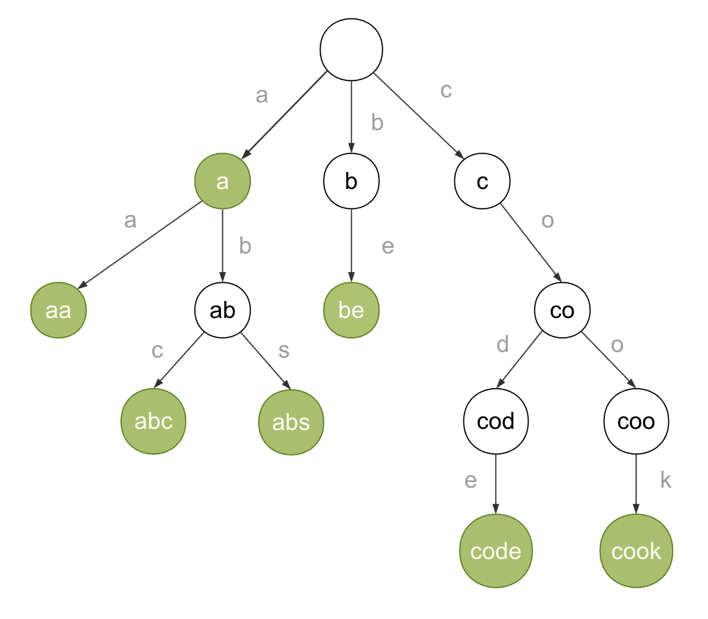

## 实现 Trie（前缀树）

### 问题

Trie（发音类似 "try"）或者说 **前缀树** 是一种树形数据结构，用于高效地存储和检索字符串数据集中的键。这一数据结构有相当多的应用情景，例如自动补全和拼写检查。

请你实现 Trie 类：

- `Trie()` 初始化前缀树对象。
- `void insert(String word)` 向前缀树中插入字符串 `word` 。
- `boolean search(String word)` 如果字符串 `word` 在前缀树中，返回 `true`（即，在检索之前已经插入）；否则，返回 `false` 。
- `boolean startsWith(String prefix)` 如果之前已经插入的字符串 `word` 的前缀之一为 `prefix` ，返回 `true` ；否则，返回 `false` 。

提示：

- `1 <= word.length, prefix.length <= 2000`
- `word` 和 `prefix` 仅由小写英文字母组成
- `insert`、`search` 和 `startsWith` 调用次数 **总计** 不超过 $3 \times 10^4$ 次

### 思路（动态开点）

Trie 又称字典树或前缀树，是一种 $k$ 叉搜索树，是一种用于从集合中查找特定键的树形数据结构。这些键通常是字符串，还可以是 01 比特串。

Trie 的核心思想是空间换时间，利用字符串的公共前缀来减少查询时间，最大限度地减少无谓的字符串比较。

给出字符串集合

```c
"aa"
"abc"
"a"
"abs"
"code"
"cook"
"be"
```

对其建立 Trie 树如下所示：



字典树又称前缀树，给出一个字符串集合，我们可以通过公共前缀将整个字符串集合存到一个树形结构中。Trie 的 3 个性质为：

- 根节点不包含字符，除根节点外每一个节点都只包含一个字符。
- 从根节点到某一节点，路径上经过的字符连接起来，为该节点对应的字符串。
- 每个节点的所有子节点包含的字符都不相同。

一旦插入了某个字符串，在 Trie 上的相应节点打上标记，如上图的绿色节点；在查询字符串时，只需要从 Trie 的根节点开始按字符枚举并检查。

#### 时空复杂度

设字符串的平均长度为 $L$，字符串的个数为 $N$，字符集的大小为 $S$，查询次数为 $M$

时间复杂度 $O(M \cdot L)$

空间复杂度为 $O(N\cdot L \cdot S)$

#### 代码

```C++
class Trie {
private:
    vector<Trie*> children;
    bool isEnd;

    Trie* searchPrefix(string prefix) {
        Trie* node = this;
        for (char ch : prefix) {
            ch -= 'a';
            if (node->children[ch] == nullptr) {
                return nullptr;
            }
            node = node->children[ch];
        }
        return node;
    }

public:
    Trie() : children(26), isEnd(false) {}

    void insert(string word) {
        Trie* node = this;
        for (char ch : word) {
            ch -= 'a';
            if (node->children[ch] == nullptr) {
                node->children[ch] = new Trie();
            }
            node = node->children[ch];
        }
        node->isEnd = true;
    }

    bool search(string word) {
        Trie* node = this->searchPrefix(word);
        return node != nullptr && node->isEnd;
    }

    bool startsWith(string prefix) {
        return this->searchPrefix(prefix) != nullptr;
    }
};
```
