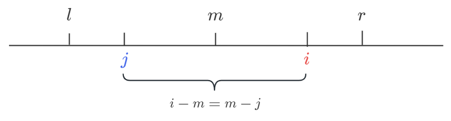
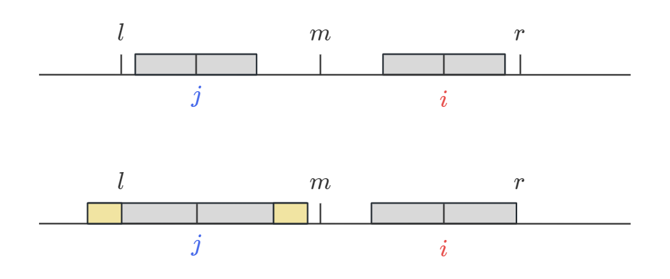

## 最长回文子串

### 问题

给你一个字符串 `s`，找到 `s` 中最长的 回文 子串。

提示：

- `1 <= s.length <= 1000`
- `s` 仅由数字和英文字母组成

### 思路一（中心扩散法）

枚举所有的**回文中心**并尝试向两边扩展，直到无法扩展为止，此时的回文串长度即为此**回文中心**下的最长回文串长度。对所有的长度求出最大值，即可得到最终的答案。要考虑两种回文中心：

- 以某个下标 $i$ 为中心
- 以两个构成回文的连续字符 $(i, i+1)$ 为中心

#### 时空复杂度

时间复杂度 $O(n^2)$

空间复杂度 $O(1)$​

#### 代码

```C++
class Solution {
public:
    pair<int, int> expandAroundCenter(const string& s, int left, int right) {
        while (left >= 0 && right < s.size() && s[left] == s[right]) {
            --left;
            ++right;
        }
        return {left + 1, right - 1};
    }

    string longestPalindrome(string s) {
        int start = 0, end = 0;
        for (int i = 0; i < s.size(); ++i) {
            auto [left1, right1] = expandAroundCenter(s, i, i);
            auto [left2, right2] = expandAroundCenter(s, i, i + 1);
            if (right1 - left1 > end - start) {
                start = left1;
                end = right1;
            }
            if (right2 - left2 > end - start) {
                start = left2;
                end = right2;
            }
        }
        return s.substr(start, end - start + 1);
    }
};
```

### 思路二（DP）

设 $f[i,j] = 0/1$ 代表区间 $[i,j]$ 的子串是否为回文串，若 $s[i] = s[j] \and f[i+1, j-1]$，则区间为 $[i, j]$ 的子串是回文串。边界要考虑单个字符和连续两个字符作为回文串的情况。

#### 时空复杂度

时间复杂度 $O(n^2)$

空间复杂度 $O(n^2)$​

#### 代码

```C++
class Solution {
public:
    string longestPalindrome(string s) {
        int n = s.size();
        int maxLen = 1;
        int begin = 0;
        vector<vector<bool>> f(n + 1, vector<bool>(n + 1, false));
        for (int i = 0; i < n; i++) {
            f[i][i] = true;
            f[i + 1][i] = true;
        }
        for (int len = 2; len <= n; len++) {
            for (int i = 0; i + len - 1 < n; i++) {
                int j = i + len - 1;
                if (s[i] == s[j] && f[i + 1][j - 1]) {
                    f[i][j] = true;
                }
                if (f[i][j] && len > maxLen) {
                    maxLen = len;
                    begin = i;
                }
            }
        }
        return s.substr(begin, maxLen);
    }
};
```

### 思路三（马拉车算法）

和中心扩散法一样，manacher 算法在处理时也会遇到两种回文中心，在进行计算之前，在源字符串的 $n+1$ 个空位上填充不相关字符 `#`，例如 `abcbabb` 填充后得到目标字符串 `#a#b#c#b#a#b#b#`。可以发现在填充后，源字符串的任何一个长度为 $x$ 的回文子串，都会对应于目标字符串中一个**奇数**长度 $2n + 1$ 的回文子串。以下称填充后的目标字符串为 $s$，其所有回文子串长度均为**奇数**。

定义 $rad[i]$ 代表下标 $i$ 位置字符的最长回文半径，具体的说，从位置 $i$ 开始通过中心扩散法计算，得到的以 $i$ 为中心的回文子串对应下标区间为 $[i - rad[i], i + rad[i]]$，那么源字符串中该回文子串的长度即为 $rad[i]$。例如， `#a#b#c#b#a#b#b#` 中字符 '`c`' 对应的 $rad[5] = 5$，倒数第二个 `#` 对应的 $rad[12]=2$。定义**最右回文子串**代表已经处理过字符串前缀中，**右边界最大**的回文子串，记录该回文子串的左边界为 $l$，中心为 $mid$，右边界为 $r$。

算法主体分为三步，第一步是**找到以 $i$ 为中心点已知的最小回文半径**，第二步是**利用中心扩散法更新回文半径**，第三步是**更新最右回文子串**。求出字符串 $s$ 的 $rad[i], 0 \leq i \leq |s|$ 后，**源字符串**的最长回文子串的长度即为
$$
\max_\limits{0 \leq i < |s|}\{rad[i]\}
$$

**1. 最小回文半径**

已知**最右回文子串**的左右边界和中心，因为最右回文子串的中心即为字符串 $s$ 中已经处理的下标，那么一定满足 $mid < i$。考虑当前下标 $i$ 与最右回文子串**右边界** $r$ 的关系：若 $r < i$，即找不到任何已知的最长回文半径，暂时令 $rad[i] = 0$。

当下标 $i$ 处在 $(mid, r]$ 之间时，因为区间 $[l, r]$ 是一个回文子串，那么一定可以找到一个对称的 $j, l \leq j < mid$，满足 $s[i] = s[j]$：



而且 $[l, j]$ 和 $[i, r]$ 关于中心点对称，考虑 $rad[j]$ 会有如下图的两种情况：



- 若 $l \leq j - rad[j]$，或者说 $i + rad[j] \leq  r$，则对于当前下标 $i$ 来说，已知的回文半径至少是 $rad[j]$。
- 若 $j - rad[j] < l$，或者说 $r < i + rad[j]$，黄色区域并没有被**最右回文子串**包含，也就是无法判断以 $i$ 为中心点后多余的黄色区域对称过来是否回文。则对于当前下标 $i$ 来说，已知的回文半径至少是 $r - i$。

**2. 中心扩散**

求出最小回文半径后，使用中心扩散法向两边延伸，求出以 $i$ 为中心点的最长回文半径 $rad[i]$。

**3. 最右回文子串**

求出 $rad[i]$ 后，判断是否更新最右回文子串。

#### 时空复杂度

该算法类似于一个双指针的过程，**最右回文子串的右边界单调不减**，枚举下标 $i$ 单调递增，时间复杂度为 $O(n)$

空间复杂度 $O(n)$​

#### 代码

```C++
class Solution {
public:
    string manacher(string str) {
        string s = "#";
        for(int i = 0; i < str.size(); i++) {
            s += str[i];
            s += '#';
        }
        int n = s.size();
        vector<int> rad(n + 1, 0);
        int l = 0, mid = 0, r = 0;
        for(int i = 1; i < n; i++) {
            if(i <= r) {
                int symPos = mid - (i - mid);
                rad[i] = min(r - i, rad[symPos]);
            } else {
                rad[i] = 0;
            }
            int j = i - rad[i], k = i + rad[i];
            while(j >= 0 && k < n && s[j] == s[k]) {
                j--, k++;
            }
            j++, k--;
            rad[i] = k - i;
            if(k > r) {
                l = j;
                r = k;
                mid = (l + r) >> 1;
            }
        }
        int maxLen = 0;
        string ans = "";
        for(int i = 1; i < n; i++) {
            if(rad[i] > maxLen) {
                mid = i;
                maxLen = rad[i];
            }
        }
        for(int i = mid - maxLen; i <= mid + maxLen; i++) {
            if(s[i] != '#') {
                ans += s[i];
            }
        }
        return ans;
    }

    string longestPalindrome(string s) {
        return manacher(s);
    }
};
```

