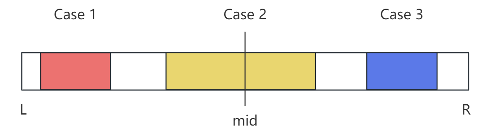

## 最大子数组和

### 问题

给你一个整数数组 `nums` ，请你找出一个具有最大和的连续子数组（子数组最少包含一个元素），返回其最大和。

**子数组**是数组中的一个连续部分。

提示：

- $1 \leq$ `nums.length` $\leq 10^5$
- $-10^4 \leq$ `nums[i]` $\leq 10^4$

### 思路一（前缀和）

根据前缀和的思想，任何一个连续子数组都可以表示为**两个前缀和的差**。当固定前缀和的右边界时，只需要找到前缀中最小的前缀和作为左边界。

#### 时空复杂度

时间复杂度 $O(n)$

空间复杂度 $O(n)$​

#### 代码

```C++
class Solution {
public:
    int maxSubArray(vector<int>& nums) {
        int n = nums.size();
        vector<int> sum(n + 1, 0);
        int pre = 0, ans = INT_MIN;
        for (int i = 1; i <= n; i++) {
            sum[i] = sum[i - 1] + nums[i - 1];
            ans = max(ans, sum[i] - pre);
            pre = min(pre, sum[i]);
        }
        return ans;
    }
};
```

### 思路二（分治）

对于每一段区间一分为二，可以发现：该区间的最大前缀和有下面三种情况：

1. 完全在中点的左侧；
2. 完全在中点的右侧；
3. 跨越中点的一段连续区间。



如何实现分治：

- 若区间长度为 1，返回当前区间的唯一值
- 否则，将问题划分为两个子问题 $[l, mid],[mid + 1, r]$，分别递归求出两个子区间的最大子数组和后，还需要考虑跨越中点的最大连续和：即分别求出左区间的**最大连续后缀和**、右区间的**最大连续前缀和**，二者的和就是跨越中点的最大连续和。

#### 时空复杂度

时间复杂度 $O(n \log n)$

空间复杂度 $O(\log n)$​

#### 代码

```C++
class Solution {
public:
    int getMaxSum(vector<int>& nums, int l, int r) {
        if (l == r) return nums[l];
        int mid = (l + r) >> 1;
        int ans = max(getMaxSum(nums, l, mid), getMaxSum(nums, mid + 1, r));
        int L = INT_MIN, R = INT_MIN;
        int sum = 0;
        for (int i = mid; i >= l; i--) L = max(L, sum += nums[i]);
        sum = 0;
        for (int i = mid + 1; i <= r; i++) R = max(R, sum += nums[i]);
        return max(ans, L + R);
    }

    int maxSubArray(vector<int>& nums) {
        return getMaxSum(nums, 0, nums.size() - 1);
    }
};
```

### 思路三（分治优化）

在简单分治做法中，每段区间都需要从中点向两侧枚举。考虑优化这一过程，使用状态结构体表示递归函数返回值：**{区间和 `sum`，最大子数组和 `maxSum`，前缀最大值 `preMax`，后缀最大值 `sufMax`}**，设左子区间的返回状态为 `left`，右子区间的返回值为 `right`

- 区间和 `sum = left.sum + right.sum;`
- 最大子数组和 `maxSum = max(max(left.maxSum, right.maxSum), left.sufSum + right.preSum);`
- 前缀最大值 `preSum = max(left.preSum, left.sum + right.preSum);`
- 后缀最大值 `sufSum = max(right.sufSum, right.sum + left.sufSum);`

#### 时空复杂度

时间复杂度 $O(n)$

空间复杂度 $O(\log n)$​

#### 代码

```C++
class Solution {
private:
    struct Status {
        int sum;
        int maxSum;
        int preSum;
        int sufSum;
    };
public:
    Status getMaxSum(vector<int>& nums, int l, int r) {
        if (l == r) {
            return {nums[l], nums[l], nums[l], nums[l]};
        }
        int mid = (l + r) >> 1;
        Status left = getMaxSum(nums, l, mid);
        Status right = getMaxSum(nums, mid + 1, r);
        Status ans;
        ans.sum = left.sum + right.sum;
        ans.maxSum = max(max(left.maxSum, right.maxSum), left.sufSum + right.preSum);
        ans.preSum = max(left.preSum, left.sum + right.preSum);
        ans.sufSum = max(right.sufSum, right.sum + left.sufSum);
        return ans;
    }

    int maxSubArray(vector<int>& nums) {
        Status ans = getMaxSum(nums, 0, nums.size() - 1);
        return ans.maxSum;
    }
};
```

### 思路四（动态规划）

设 $f[i]$ 代表以第 $i$ 个数结尾的最大子数组和，考虑 $nums[i]$ 单独成为一段还是加入 $f[i-1]$ 对应的那一段，这取决于 $nums[i]$ 和 $f[i - 1] + nums[i]$ 的大小，因此状态转移方程为：
$$
f[i] = max(f[i - 1] + nums[i], nums[i])
$$
此时答案为 $\max\{f[i]\}$。考虑到状态 $f[i]$ 只与状态 $f[i-1]$ 相关，类似**滚动数组**的思想，可以利用两个变量完成状态转移和答案更新。

#### 时空复杂度

时间复杂度 $O(n)$

空间复杂度 $O(1)$​

#### 代码

```C++
class Solution {
public:
    int maxSubArray(vector<int>& nums) {
        int pre = 0, ans = nums[0];
        for (const auto &x: nums) {
            pre = max(pre + x, x);
            ans = max(ans, pre);
        }
        return ans;
    }
};
```

