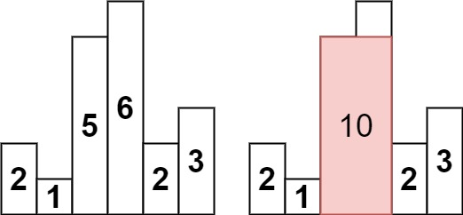

## 柱状图中最大的矩形

### 问题

给定 *n* 个非负整数，用来表示柱状图中各个柱子的高度。每个柱子彼此相邻，且宽度为 1 。

求在该柱状图中，能够勾勒出来的矩形的最大面积。



提示：

- $1\leq$ `heights.length` $\leq 10^5$
- $0\leq$ `heights[i]` $\leq 10^4$

### 思路（单调栈）

对于每个元素来说，包含它的最大矩形具备特征：该矩形的左边界是前缀中大于等于它的最后一个元素，右边界是后缀中大于等于它的最后一个元素。根据单调栈的经典模型，预处理每个元素前缀中第一个小于它的位置、后缀中第一个小于它的位置，最后遍历每个元素求解。

从另外一个角度看问题，如果矩形的高度从左到右单调递增，那么可以尝试把每个矩形的高度作为最终矩形的高度，并把宽度延伸到右边界得到一个新矩形，所有这样的矩形面积中取最大值就是答案。如果下一个矩形的高度比上一个小，那么该矩形想利用之前的矩形一起构成一块较大的面积时，这块矩形的高度就不可能超过该矩形自己的高度，因此之前累计的比它高的矩形都没有用了。把之前比该矩形高的矩形都删掉，用一个宽度累加、高度为该矩形自己高度的新矩形代替，对后面答案的计算没有任何影响。于是问题变成了维护高度始终递增的矩形序列，由于后进先出的性质，使用栈保存单调递增的若干矩形：

- 如果当前矩形比栈顶矩形高，则以高度为自身、宽度为 1 的矩形入栈；
- 否则不断取出栈顶，直到栈为空或者栈顶矩形的高度比当前矩形小。在出栈的过程中，累计被弹出的矩形宽度之和，并且每弹出一个矩形就用他的高度乘以累计的宽度去更新答案。整个出栈过程结束后，把一个高度为当前矩形高度、宽度为累计值的新矩形入栈。

为简化程序，在矩形序列末尾增加一个高度为 0 的矩形，避免在扫描结束后更新答案。

#### 时空复杂度

时间复杂度 $O(n)$

空间复杂度 $O(n)$​

#### 代码

```C++
class Solution {
public:
    int largestRectangleArea(vector<int>& heights) {
        heights.push_back(0);
        int n = heights.size();
        vector<pair<int, int>> stk{{n - 1, 0}};
        int ans = 0;
        for (int i = 0; i < n; i++) {
            if (heights[i] > heights[stk.back().first]) {
                stk.push_back({i, 1});
            } else {
                int width = 0;
                while (!stk.empty() && heights[stk.back().first] > heights[i]) {
                    width += stk.back().second;
                    ans = max(ans, width * heights[stk.back().first]);
                    stk.pop_back();
                }
                stk.push_back({i, width + 1});
            }
        }
        return ans;
    }
};
```
