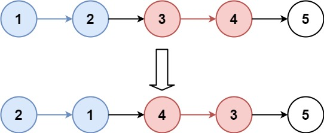

## K 个一组翻转链表

### 问题

给你链表的头节点 `head` ，每 `k` 个节点一组进行翻转，请你返回修改后的链表。

`k` 是一个正整数，它的值小于或等于链表的长度。如果节点总数不是 `k` 的整数倍，那么请将最后剩余的节点保持原有顺序。

你不能只是单纯的改变节点内部的值，而是需要实际进行节点交换。

**注意：**



提示：

- 链表中的节点数目为 `n`
- `1 <= k <= n <= 5000`
- `0 <= Node.val <= 1000`

### 思路（迭代）

首先求出链表长度，然后每 K 个节点为一组 `[start, end)`，对该区间执行**反转链表**操作（可以通过迭代反转，也可以通过递归反转）。

初始设置一个哑节点 `dummy` 指向 `head`，设操作过程中完成翻转前缀的**非空尾节点**为 `tail`，初始时 `tail = dummy`

#### 时空复杂度

时间复杂度 $O(n)$

空间复杂度 $O(1)$​

#### 代码

```C++
class Solution {
public:
    int getLength(ListNode* head) {
        int length = 0;
        while (head != nullptr) {
            ++length;
            head = head->next;
        }
        return length;
    }

    ListNode *reverseList(ListNode *start, ListNode *end) {
        ListNode *preHead = nullptr, *first = start, *second;
        while (first != end) {
            second = first->next;
            first->next = preHead;
            preHead = first;
            first = second;
        }
        return preHead;
    }

    ListNode* reverseKGroup(ListNode* head, int k) {
        if (k == 1) return head;
        int n = getLength(head);
        ListNode *dummy = new ListNode(0, head);
        ListNode *tail = dummy;
        ListNode *end = head;
        for (int i = 0; i < n; i += k) {
            int len = 0;
            ListNode *start = end;
            while (end != nullptr && len < k) {
                ++len;
                end = end->next;
            }
            if (len < k) {
                tail->next = start;
                break;  
            }
            tail->next = reverseList(start, end);
            tail = start;
        }
        return dummy->next;
    }
};
```

