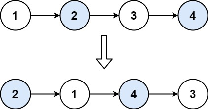

## 两两交换链表中的节点

### 问题

给你一个链表，两两交换其中相邻的节点，并返回交换后链表的头节点。你必须在不修改节点内部的值的情况下完成本题（即，只能进行节点交换）。

**注意：**



提示：

- 链表中节点的数目在范围 `[0, 100]` 内
- `0 <= Node.val <= 100`

### 思路一（递归）

假设考虑当前问题链表的长度为 $n$，对于前两个节点 $l,r$，将后续所有 $n - 2$ 个节点两两交换看作子问题，若求出了子问题的头节点 $h$，那么令 $l \rightarrow next = h, r \rightarrow next = l$，最终当前问题求解的头节点就是 $r$

递归的终止条件为链表长度小于 2，递归的返回值为更新后的 $r$

#### 时空复杂度

时间复杂度 $O(n)$

空间复杂度 $O(n)$​

#### 代码

```C++
class Solution {
public:
    ListNode* swapPairs(ListNode* head) {
        if (!head || !head->next) return head;
        ListNode *first = head, *second = head->next;
        first->next = swapPairs(second->next);
        second->next = first;
        return second;
    }
};
```

### 思路二（迭代）

将整个链表分为两部分，一部分已经完成两两交换，另一部分未完成两两交换。对于前部分需要 **记录非空尾节点 $t$**，对另一部分的前两个节点 $l,r$ 交换的步骤为：

- $l \rightarrow next = r \rightarrow next$
- $r \rightarrow next = l$
- $t \rightarrow next = r$​

交换后将这两个节点视为已完成部分，重新赋值上述三个指针，重复该过程直到未完成部分链表长度小于 2

#### 时空复杂度

时间复杂度 $O(n)$

空间复杂度 $O(1)$​

#### 代码

```C++
class Solution {
public:
    ListNode* swapPairs(ListNode* head) {
        if (!head || !head->next) return head;
        ListNode *dummy = new ListNode(0, head);
        ListNode *tail = dummy, *first = head, *second;
        while (first != nullptr && first->next != nullptr) {
            second = first->next;
            first->next = second->next;
            second->next = first;
            tail->next = second;
            tail = first;
            first = first->next;
        }
        return dummy->next;
    }
};
```

