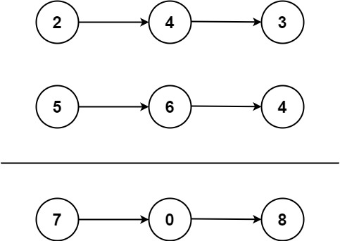

## 两数相加

### 问题

给你两个 **非空** 的链表，表示两个非负的整数。它们每位数字都是按照 **逆序** 的方式存储的，并且每个节点只能存储 **一位** 数字。

请你将两个数相加，并以相同形式返回一个表示和的链表。

你可以假设除了数字 0 之外，这两个数都不会以 0 开头。

**注意：**



提示：

- 每个链表中的节点数在范围 `[1, 100]` 内
- `0 <= Node.val <= 9`
- 题目数据保证列表表示的数字不含前导零

### 思路一（递归）

由于输入的两个链表都是**逆序**存储数字的位数的，因此两个链表中同一位置的数字可以直接相加。如果两个链表的长度不同，则可以认为长度短的链表的后面有若干个 0，等效于两个长度相同的链表相加。

假设当前计算到了链表 1 的头节点到 $l_1$、链表 2 的头节点到 $l_2$，上一位的进位为 $p$

- 若 $l_1$ 为空，求出当前数位的值和进位后，递归处理链表 2 的下一个节点到尾节点的子问题；
- 若 $l_2$ 为空，求出当前数位的值和进位后，递归处理链表 1 的下一个节点到尾节点的子问题；
- 否则求出当前数位的值和进位后，递归处理链表 1 和链表 2 的下一个节点到尾节点的子问题；

递归的边界是当两个指针都为空，若有上一位的进位，则新增一个最高数位的节点，否则返回空节点。递归的返回值是子问题求和后的**最低位**（子问题求和后链表的头节点）

递归处理的过程相当于**从后到前构造求和后的链表，构造的正确性依赖于递归栈，保存了每个子问题求解前的状态和子问题求解后的返回值**。

#### 时空复杂度

时间复杂度 $O(n + m)$

空间复杂度 $O(n + m)$​

#### 代码

```C++
class Solution {
public:
    ListNode* add(ListNode *l1, ListNode *l2, int pre) {
        if (!l1 && !l2) {
            if (pre) return new ListNode(pre);
            return nullptr;
        }
        if (!l1) {
            ListNode* cur = new ListNode(l2->val + pre);
            if (cur->val - 10 >= 0) {
                cur->val -= 10;
                cur->next = add(l1, l2->next, 1);
            } else {
                cur->next = add(l1, l2->next, 0);
            }
            return cur;
        }
        if (!l2) {
            ListNode* cur = new ListNode(l1->val + pre);
            if (cur->val - 10 >= 0) {
                cur->val -= 10;
                cur->next = add(l1->next, l2, 1);
            } else {
                cur->next = add(l1->next, l2, 0);
            }
            return cur;
        }
        ListNode* cur = new ListNode(l1->val + l2->val + pre);
        if (cur->val - 10 >= 0) {
            cur->val -= 10;
            cur->next = add(l1->next, l2->next, 1);
        } else {
            cur->next = add(l1->next, l2->next, 0);
        }
        return cur;
    }

    ListNode* addTwoNumbers(ListNode* l1, ListNode* l2) {
        return add(l1, l2, 0);
    }
};
```

### 思路二（迭代）

由于输入的两个链表都是**逆序**存储数字的位数的，因此两个链表中同一位置的数字可以直接相加。如果两个链表的长度不同，则可以认为长度短的链表的后面有若干个 0，等效于两个长度相同的链表相加。

设置两个指针分别指向两个链表的头节点，迭代处理的过程等效于并行移动两个指针，并在移动的过程中处理进位。如果链表遍历结束后，上一位的进位大于 0，还需要在答案链表的后面附加一个最高位节点。

迭代处理的过程相当于**从前到后构造求和后的链表**。

#### 时空复杂度

时间复杂度 $O(n + m)$

空间复杂度 $O(1)$​

#### 代码

```C++
class Solution {
public:
    ListNode* addTwoNumbers(ListNode* l1, ListNode* l2) {
        ListNode* root = new ListNode();
        ListNode* cur = root;
        int pre = 0;
        while (l1 != nullptr || l2 != nullptr) {
            cur->val = pre;
            if (l1 != nullptr) {
                cur->val += l1->val;
                l1 = l1->next;
            }
            if (l2 != nullptr) {
                cur->val += l2->val;
                l2 = l2->next;
            }
            if (cur->val >= 10) {
                cur->val -= 10;
                pre = 1;
            } else
                pre = 0;
            if (l1 == nullptr && l2 == nullptr)
                break;
            cur->next = new ListNode();
            cur = cur->next;
        }
        if (pre) {
            cur->next = new ListNode();
            cur->next->val = pre;
        }
        return root;
    }
};
```

