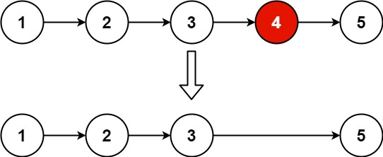

## 删除链表的倒数第N个结点

### 问题

给你一个链表，删除链表的倒数第 `n` 个结点，并且返回链表的头结点。

**注意：**



提示：

- 链表中结点的数目为 `sz`
- `1 <= sz <= 30`
- `0 <= Node.val <= 100`
- `1 <= n <= sz`

### 思路一（计算链表长度）

直观的思路是，计算链表的长度为 $m$，要删除的节点就是从头节点开始的第 $m - n + 1$ 个节点。只需要找到第 $m - n$ 个节点，它的下一个节点就是要删除的节点。需要特判要删除的节点是首尾节点。

引入哑节点可以优雅的解决问题，设 0 号节点指向头节点，那么问题变成了找到第 $m - n + 1$ 个节点，它的下一个节点就是要删除的节点，无任何临界情况。

#### 时空复杂度

时间复杂度 $O(n)$

空间复杂度 $O(1)$​

#### 代码

```C++
class Solution {
public:
    int getLength(ListNode* head) {
        int length = 0;
        while (head != nullptr) {
            ++length;
            head = head->next;
        }
        return length;
    }

    ListNode* removeNthFromEnd(ListNode* head, int n) {
        ListNode* dummy = new ListNode(0, head);
        int length = getLength(head);
        ListNode* cur = dummy;
        for (int i = 1; i < length - n + 1; ++i) {
            cur = cur->next;
        }
        ListNode *delNode = cur->next;
        cur->next = cur->next->next;
        ListNode* ans = dummy->next;
        delete dummy;
        delete delNode;
        return ans;
    }
};
```

### 思路二（递归）

在递归求出每个节点处于倒数第 $i$ 个节点的过程中解决问题。当节点为倒数第 $n+1$ 个节点时，删除倒数第 $n$ 个节点。

为了不考虑删除的节点是首尾节点的边界情况，同样可以引入哑节点 0 号节点指向头节点。

#### 时空复杂度

时间复杂度 $O(n)$

空间复杂度 $O(n)$​

#### 代码

```C++
class Solution {
private:
    int delIdx;
public:
    int delNthNode(ListNode* head) {
        if (head == nullptr) return 0;
        int idx = delNthNode(head->next) + 1;
        if (idx == delIdx + 1) {
            ListNode *delNode = head->next;
            head->next = head->next->next;
            delete delNode;
        }
        return idx;
    }

    ListNode* removeNthFromEnd(ListNode* head, int n) {
        delIdx = n;
        ListNode *dummy = new ListNode(0, head);
        delNthNode(dummy);
        ListNode *ans = dummy->next;
        delete dummy;
        return ans;
    }
};
```

### 思路三（双指针）

倒数第 $n$ 个节点距离尾部空指针的长度为 $n$，假设最终两个指针 $l,r$，$l$ 指向倒数第 $n$ 个节点，$r$ 指向尾部空节点。将两个指针同步向前移动，任何时候二者的距离均为 $n$，直到 $l$ 移动到头节点的位置。将该过程反过来，初始令 $l$ 为头节点，$r$ 为正数第 $n$ 个节点，同步移动两个指针，当 $r$ 指向尾部空节点时，$l$ 指向的就是倒数第 $n$​ 个节点。 

删除倒数第 $n$ 个节点需要找到倒数第 $n+1$ 个节点，引入哑节点 0 号节点指向头节点，可以避免处理边界情况。

#### 时空复杂度

时间复杂度 $O(n)$

空间复杂度 $O(1)$​

#### 代码

```C++
class Solution {
public:
    ListNode* removeNthFromEnd(ListNode* head, int n) {
        ListNode *dummy = new ListNode(0, head);
        ListNode *l = dummy, *r = head;
        for (int i = 0; i < n; ++i) {
            r = r->next;
        }
        while (r != nullptr) {
            l = l->next;
            r = r->next;
        }
        ListNode *delNode = l->next;
        l->next = l->next->next;
        ListNode* ans = dummy->next;
        delete dummy;
        delete delNode;
        return ans;
    }
};
```

