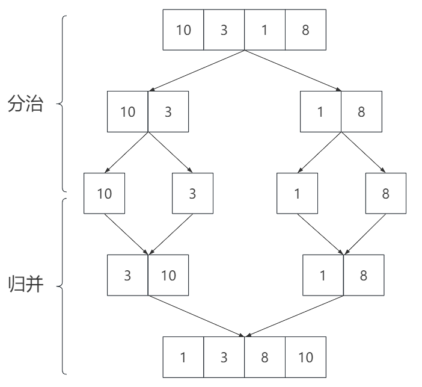
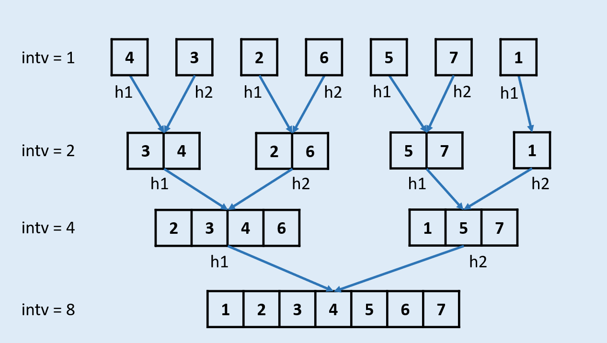

## 排序链表

### 问题

给你链表的头结点 `head` ，请将其按 **升序** 排列并返回 **排序后的链表** 。

**注意：**

你可以在 $O(n \log n)$ 时间复杂度和常数级空间复杂度下，对链表进行排序吗？

提示：

- 链表中节点的数目在范围 $[0, 5 \times 10^4]$ 内
- $-10^5 \leq $ `Node.val` $\leq 10^5$

### 思路一（归并排序-递归）

归并排序是建立在归并操作上的一种高效稳定的排序算法，其核心思想为**分治**，时间复杂度 $O(n \log n)$，空间复杂度 $O(n)$

采用自顶向下的思路，将区间 $[l, r]$ 分为 $[l,mid], [mid + 1, r]$ 两部分，先将两个**无序**子序列递归排序，回溯时对两个**有序**子序列归并。

算法流程图如下所示：



注意可以通过龟兔赛跑算法（快慢双指针）寻找区间中点。

#### 时空复杂度

时间复杂度 $O(n \log n)$

空间复杂度 $O(\log n)$​

#### 代码

```C++
class Solution {
public:
    ListNode* merge(ListNode* head1, ListNode* head2) {
        ListNode dummy(0);
        ListNode *temp = &dummy;
        while (head1 != nullptr && head2 != nullptr) {
            if (head1->val <= head2->val) {
                temp->next = head1;
                head1 = head1->next;
            } else {
                temp->next = head2;
                head2 = head2->next;
            }
            temp = temp->next;
        }
        if (head1 != nullptr) {
            temp->next = head1;
        } else {
            temp->next = head2;
        }
        return dummy.next;
    }

    ListNode* mergeSort(ListNode* head, ListNode* tail) {
        if (head == nullptr) return head;
        if (head->next == tail) {
            head->next = nullptr;
            return head;
        }
        ListNode *l = head, *r = head;
        while (r != tail && r->next != tail) {
            l = l->next;
            r = r->next->next;
        }
        ListNode *mid = l;
        l = mergeSort(head, mid);
        r = mergeSort(mid, tail);
        return merge(l, r);
    }

    ListNode* sortList(ListNode* head) {
        return mergeSort(head, nullptr);
    }
};
```

### 思路二（归并排序-迭代）

递归的过程本质是**自顶向下**通过不断二分，直到找到长度为 1 的区间，在回溯的过程中两两相邻区间合并。

这个过程反过来同样可以**自底向上**进行：从长度为 1 的区间开始，两两相邻区间执行归并操作（归并时保证已经有序），直到整个大区间完成排序。



#### 时空复杂度

时间复杂度 $O(n \log n)$

空间复杂度 $O(1)$​

#### 代码

```C++
class Solution {
public:
    ListNode* sortList(ListNode* head) {
        if (head == nullptr) {
            return head;
        }
        int length = 0;
        ListNode* node = head;
        while (node != nullptr) {
            length++;
            node = node->next;
        }
        ListNode* dummyHead = new ListNode(0, head);
        for (int subLength = 1; subLength < length; subLength <<= 1) {
            ListNode* prev = dummyHead, *curr = dummyHead->next;
            while (curr != nullptr) {
                ListNode* head1 = curr;
                for (int i = 1; i < subLength && curr->next != nullptr; i++) {
                    curr = curr->next;
                }
                ListNode* head2 = curr->next;
                curr->next = nullptr;
                curr = head2;
                for (int i = 1; i < subLength && curr != nullptr && curr->next != nullptr; i++) {
                    curr = curr->next;
                }
                ListNode* next = nullptr;
                if (curr != nullptr) {
                    next = curr->next;
                    curr->next = nullptr;
                }
                ListNode* merged = merge(head1, head2);
                prev->next = merged;
                while (prev->next != nullptr) {
                    prev = prev->next;
                }
                curr = next;
            }
        }
        return dummyHead->next;
    }

    ListNode* merge(ListNode* head1, ListNode* head2) {
        ListNode* dummyHead = new ListNode(0);
        ListNode* temp = dummyHead, *temp1 = head1, *temp2 = head2;
        while (temp1 != nullptr && temp2 != nullptr) {
            if (temp1->val <= temp2->val) {
                temp->next = temp1;
                temp1 = temp1->next;
            } else {
                temp->next = temp2;
                temp2 = temp2->next;
            }
            temp = temp->next;
        }
        if (temp1 != nullptr) {
            temp->next = temp1;
        } else if (temp2 != nullptr) {
            temp->next = temp2;
        }
        return dummyHead->next;
    }
};
```

### 思路三（堆排序）

堆排序是一种稳定的排序，将所有节点放入堆中，并定义出堆规则。

#### 时空复杂度

时间复杂度 $O(n \log n)$

空间复杂度 $O(n)$

```c++
class Solution {
public:
    ListNode* sortList(ListNode* head) {
        if (head == nullptr) {
            return head;
        }
        auto cmp = [](ListNode *a, ListNode *b) -> bool { 
            return a->val > b->val; 
        };
        priority_queue<ListNode*, vector<ListNode*>, decltype(cmp)> q;
        ListNode *cur = head;
        while (cur != nullptr) {
            q.push(cur);
            cur = cur->next;
        }
        ListNode *dummy = new ListNode(-1);
        cur = dummy;
        while (!q.empty()) {
            cur->next = q.top();
            cur = cur->next;
            q.pop();
        }
        cur->next = nullptr;
        return dummy->next;
    }
};
```

