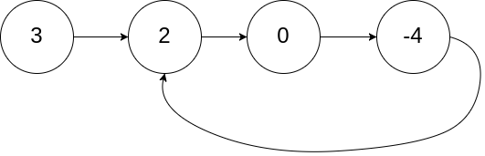
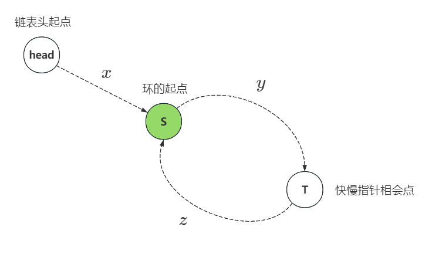

## 环形链表 II

### 问题

给定一个链表的头节点  `head` ，返回链表开始入环的第一个节点。 *如果链表无环，则返回 `null`。*

如果链表中有某个节点，可以通过连续跟踪 `next` 指针再次到达，则链表中存在环。 为了表示给定链表中的环，评测系统内部使用整数 `pos` 来表示链表尾连接到链表中的位置（**索引从 0 开始**）。如果 `pos` 是 `-1`，则在该链表中没有环。**注意：`pos` 不作为参数进行传递**，仅仅是为了标识链表的实际情况。

**不允许修改** 链表。

**注意：**



提示：

- 链表中节点的数目范围在范围 $[0,10^4]$ 内
- $-10^5 \leq$ `Node.val` $\leq 10^5$
- `pos` 的值为 `-1` 或者链表中的一个有效索引

### 思路一（哈希表）

使用哈希表记录节点是否已经访问：

- 若当前节点为空，则返回空节点
- 否则一定会循环到已经出现的节点，返回第一次重复出现的节点

#### 时空复杂度

时间复杂度 $O(n)$

空间复杂度 $O(n)$​

#### 代码

```C++
class Solution {
public:
    ListNode *detectCycle(ListNode *head) {
        unordered_map<ListNode*, bool> mp;
        while (head != nullptr) {
            if (mp.count(head)) {
                return head;
            }
            mp[head] = true;
            head = head->next;
        }
        return nullptr;
    }
};
```

### 思路二（双指针）

龟兔赛跑算法又称 Floyd 判环法，其核心思想就是双指针。设置两个指针初始均指向链表的头部，每次移动时，快指针向前走 $2$ 步，慢指针向前走 $1$​​ 步。重复移动过程，当两个指针**第一次相会**时，代表链表存在环。

固定一个指针，再移动另一个指针直到相遇，走过的距离就是环的长度。

如何求出环的起点？



如上图所示，设环的长度 $n = y + z$。快慢指针第一次相会时，慢指针在环上走了 $y(0 \leq y \leq n)$ 步，快指针绕着环已经走了 $y + k \cdot n(k > 0)$ 步。慢指针走过的距离为 $s_1 = x + y$，快指针走过的距离为 $s_2 = x + k \cdot n + y$，又因为快指针速度是慢指针的两倍，则 $s_2 = 2 \times s_1$，即：
$$
2(x + y) = x + k \cdot n + y \\
x + y = k \cdot n
$$
又因为 $y + z = n$，则：
$$
x = (k - 1) \cdot n + z
$$
令一个指针从相遇点开始走，另一个指针从链表头节点开始走，二者均一次走 $1$ 步。当两个指针再次相遇时，相遇点就是环的起点。

#### 时空复杂度

时间复杂度 $O(n)$

空间复杂度 $O(1)$

#### 代码

```C++
class Solution {
public:
    ListNode *detectCycle(ListNode *head) {
        if (!head) return nullptr;
        ListNode *l = head, *r = head;
        bool hasCycle = false;
        while (r->next != nullptr && r->next->next != nullptr) {
            l = l->next;
            r = r->next->next;
            if (l == r) {
                hasCycle = true;
                break;
            }
        }
        if (!hasCycle) {
            return nullptr;
        }
        r = head;
        while (l != r) {
            l = l->next;
            r = r->next;
        }
        return l;
    }
};
```

