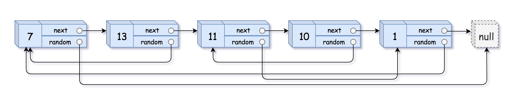

## 随机链表的复制

### 问题

给你一个长度为 `n` 的链表，每个节点包含一个额外增加的随机指针 `random` ，该指针可以指向链表中的任何节点或空节点。

构造这个链表的 **深拷贝**。 深拷贝应该正好由 `n` 个 **全新** 节点组成，其中每个新节点的值都设为其对应的原节点的值。新节点的 `next` 指针和 `random` 指针也都应指向复制链表中的新节点，并使原链表和复制链表中的这些指针能够表示相同的链表状态。**复制链表中的指针都不应指向原链表中的节点** 。

例如，如果原链表中有 `X` 和 `Y` 两个节点，其中 `X.random --> Y` 。那么在复制链表中对应的两个节点 `x` 和 `y` ，同样有 `x.random --> y` 。

返回复制链表的头节点。

用一个由 `n` 个节点组成的链表来表示输入/输出中的链表。每个节点用一个 `[val, random_index]` 表示：

- `val`：一个表示 `Node.val` 的整数。
- `random_index`：随机指针指向的节点索引（范围从 `0` 到 `n-1`）；如果不指向任何节点，则为 `null` 。

你的代码 **只** 接受原链表的头节点 `head` 作为传入参数。

**注意：**



提示：

- `0 <= n <= 1000`
- $-10^4 \leq $ `Node.val` $\leq 10^4$
- `Node.random` 为 `null` 或指向链表中的节点。

### 思路一（哈希表）

首先按照链表的 next 指针从头到尾遍历链表，并完成新链表从头到尾 next 的连接，在遍历链表的过程中用哈希表存储**旧节点-新节点**键值对。

设置两个指针分别指向新旧链表的头节点，根据旧链表指针节点的 random 节点，从哈希表中找到对应新链表指针节点对应的 random 节点，重复该过程直到遍历完整个链表。

#### 时空复杂度

时间复杂度 $O(n)$

空间复杂度 $O(n)$​

#### 代码

```C++
class Solution {
public:
    Node* copyRandomList(Node* head) {
        if (head == nullptr) return head;

        unordered_map<Node*, Node*> mp;
        Node *dummy = new Node(0);
        Node *curNew = dummy;

        Node *curOld = head;
        while (curOld != nullptr) {
            Node *now = new Node(curOld->val);
            curNew->next = now;
            mp[curOld] = now;
            if (mp.count(curOld->random)) {
                now->random = mp[curOld->random];
            }

            curNew = curNew->next;
            curOld = curOld->next;
        }

        curNew = dummy->next;
        curOld = head;
        while (curOld != nullptr) {
            curNew->random = mp[curOld->random];
            curNew = curNew->next;
            curOld = curOld->next;
        }

        return dummy->next;
    }
};
```

### 思路二（节点拆分）

首先将链表每一个节点拆分为两个相邻的节点，例如对于链表 $A \rightarrow B \rightarrow C$，可以将其拆分为 $A \rightarrow A' \rightarrow B \rightarrow B' \rightarrow C \rightarrow C'$，其中拷贝节点 $S'$ 即为每个原节点的后继节点。

对于长度为 $2 \times n$ 的拆分链表，按照 $\text{next}$ 指针执行 $O(n)$ 的遍历，对于对于原节点 $X$ 和其拷贝节点 $X'$，那么有 $X' \rightarrow \text{random} = X \rightarrow \text{random} \rightarrow \text{next}$，注意特判 $X \rightarrow \text{random} = \varnothing$ 的情况。

最后再执行一次遍历拆分两个链表，使用哑节点 `dummy` 可以避免特殊情况的判断。

#### 时空复杂度

时间复杂度 $O(n)$

空间复杂度 $O(1)$

#### 代码

```c++
class Solution {
public:
    Node* copyRandomList(Node* head) {
        if (head == nullptr) return head;
        Node *list1 = head, *temp;
        while (list1 != nullptr) {
            Node *now = new Node(list1->val);
            temp = list1->next;
            list1->next = now;
            now->next = temp;
            list1 = temp;
        }
        list1 = head;
        while (list1 != nullptr) {
            if (list1->random != nullptr) {
                list1->next->random = list1->random->next;
            } else {
                list1->next->random = nullptr;
            }
            list1 = list1->next->next;
        }
        Node *dummy = new Node(-1);
        Node *list2 = dummy;
        list1 = head;
        while (list1 != nullptr) {
            list2->next = list1->next;
            list2 = list2->next;
            list1->next = list2->next;
            list1 = list1->next;
        }
        return dummy->next;
    }
};
```

